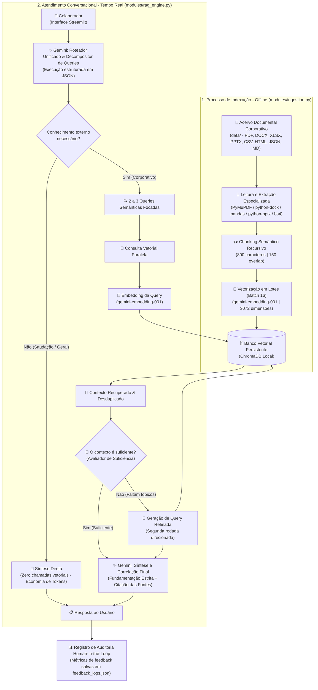

# 🤖 Alura Agent | Base de Conhecimento RAG Corporativo

[](https://www.python.org/)
[](https://ai.google.dev/)
[](https://streamlit.io/)
[](https://www.trychroma.com/)
[](LICENSE)

> **Assistente Corporativo Inteligente com Arquitetura Agentic RAG, Roteamento JSON Unificado, Auto-Refinamento Reflexivo e Governança Documental Multiformato.**

O **Alura Agent** é uma solução corporativa de Inteligência Artificial desenhada sob o padrão **Agentic RAG (Retrieval-Augmented Generation)**. Desenvolvido para atuar como o ponto central de consulta interna de colaboradores, o assistente correlaciona políticas de Recursos Humanos, manuais de onboarding técnico, acordos de confidencialidade (NDA), relatórios setoriais de mercado, planilhas financeiras, tabelas comerciais e contratos de integração de APIs em linguagem natural, entregando respostas fundamentadas, transparentes e com citação formal das fontes corporativas.

---

## 📌 Sumário

1. [✨ Diferenciais e Recursos Centrais](#-diferenciais-e-recursos-centrais)
2. [🏗️ Arquitetura e Engenharia do Sistema](#️-arquitetura-e-engenharia-do-sistema)
   - [Fluxograma Completo (Mermaid)](#-fluxograma-do-sistema-mermaid)
   - [Pipeline de Ingestão Multiformato](#1-pipeline-de-ingestão-offline-modulesingestionpy)
   - [Motor Agentic RAG em Tempo Real](#2-motor-agentic-rag-em-tempo-real-modulesrag_enginepy)
3. [🛠️ Stack Tecnológica](#️-stack-tecnológica)
4. [📁 Estrutura do Repositório](#-estrutura-do-repositório)
5. [🚀 Instalação e Execução Passo a Passo](#-instalação-e-execução-passo-a-passo)
6. [🖥️ Guia de Uso da Interface Web](#️-guia-de-uso-da-interface-web-apppy)
7. [📚 Matriz Documental e Perguntas de Teste](#-matriz-documental-e-perguntas-de-teste)
8. [🧪 Casos de Teste Especializados](#-casos-de-teste-especializados)
9. [📊 Governança e Auditoria Human-in-the-Loop](#-governança-e-auditoria-human-in-the-loop)
10. [📝 Licença e Direitos](#-licença-e-direitos)

---

## ✨ Diferenciais e Recursos Centrais

* ⚡ **Roteamento Unificado via JSON**: O Gemini avalia a necessidade de consulta documental e gera até 3 queries semânticas decompostas em uma única chamada estruturada, cortando a latência inicial em ~50%.
* 🔁 **Auto-Refinamento Reflexivo (*Self-Correction*)**: Mecanismo inteligente que avalia a suficiência do contexto recuperado e aciona autonomamente uma 2ª rodada de busca focada caso detecte lacunas de informação.
* 🛡️ **Blindagem Rigorosa Anti-Alucinação**: O assistente correlaciona apenas evidências documentadas; caso o dado inexista, declara categoricamente a ausência sem inventar fatos.
* 📂 **Ingestão Multiformato com Extração de Tabelas**: Leitura especializada em PDFs (com PyMuPDF convertendo tabelas nativas via Pandas), planilhas Excel, tabelas CSV, Word, PowerPoint, JSON, HTML e Markdown.
* ✂️ **Chunking Semântico Hierárquico**: Segmentação de 800 caracteres com 150 de sobreposição (*overlap*) respeitando parágrafos e estruturas lógicas.
* 📊 **Telemetria e Auditoria Human-in-the-Loop**: Expansor em tempo real detalhando intenções, queries, rodadas de busca, avaliação 👍/👎 persistida em log auditável.
* 🎨 **UI Streamlit Moderna com Modo Apresentação**: Suporte universal a temas Claro/Escuro (*Dark/Light Mode*), alternador para ocultar histórico na tela e botão de limpeza rápida de sessão.

---

## 🏗️ Arquitetura e Engenharia do Sistema

O sistema opera a partir de dois macroprocessos desacoplados: **Indexação de Conhecimento Offline** e **Atendimento Conversacional em Tempo Real com Reflexão**.

### 📊 Fluxograma do Sistema (Mermaid)



---

### 🔍 Detalhamento dos Componentes

#### 1. Pipeline de Ingestão Offline (`modules/ingestion.py`)

* **Extração Especializada por Extensão**:
  * **PDFs (`PyMuPDF / fitz`)**: Captura texto com detecção automática de tabelas estruturadas (`page.find_tables()` convertidas em DataFrames Pandas), com fallback para `PyPDF` (`PdfReader`).
  * **Word (`python-docx` / `docx2txt`)**: Extração de parágrafos e células de tabelas alinhadas com delimitador ` | `.
  * **Excel (`pandas` / `openpyxl`)**: Varredura de todas as abas (`sheet_name=None`) e serialização tabular.
  * **CSV (`pandas`)**: Formatação tabular limpa para indexação de tabelas comerciais e listas de preços.
  * **PowerPoint (`python-pptx`)**: Extração recursiva de caixas de texto e formas em cada slide.
  * **JSON**: Serialização indentada legível para APIs e configurações.
  * **HTML (`BeautifulSoup4`)**: Higienização e remoção de scripts/estilos da intranet.
  * **Markdown e Texto Puro (`.md`, `.txt`)**: Leitura direta em UTF-8.
* **Chunking Semântico Recursivo**:
  * Janela de **800 caracteres** com **150 caracteres** de sobreposição (*overlap*).
  * Implementado via `RecursiveCharacterTextSplitter` com hierarquia de separadores (`\n\n`, `\n--- `, `\n`, `. `, `; `, `, `, ` `), preservando a coerência de raciocínios e tabelas.
* **Vetorização em Lote com Backoff Exponencial**:
  * Geração de vetores via `gemini-embedding-001` (3072 dimensões) com `task_type="RETRIEVAL_DOCUMENT"`.
  * Processamento em lotes de 16 blocos com retentativas automáticas e controle de taxa contra erros 429/Resource Exhausted.
* **Armazenamento no ChromaDB**:
  * Coleção persistente `documentos_empresa` em `chroma_db/`, indexando metadados completos de `source` (arquivo), `category` (departamento) e `chunk_index`.

#### 2. Motor Agentic RAG em Tempo Real (`modules/rag_engine.py`)

* **Roteamento Inteligente e Decomposição (`route_and_generate_queries`)**:
  * Em uma única chamada JSON, o modelo classifica a mensagem do colaborador (`needs_external_knowledge`) e desmembra perguntas compostas em queries semânticas direcionadas para busca paralela.
* **Ramo Direto (Economia de Recursos)**:
  * Mensagens cotidianas, saudações e agradecimentos são respondidos com agilidade e cordialidade sem acionar o banco vetorial.
* **Busca Adaptativa com Deduplicação (`retrieve_from_chroma`)**:
  * Consulta com embeddings `RETRIEVAL_QUERY`. Os chunks recuperados de múltiplas queries são consolidados e desduplicados por ID único (`seen_ids`). O parâmetro `top_k` é dinamicamente limitado ao total de documentos (`min(top_k, count)`).
* **Avaliador de Suficiência e Segunda Rodada (`check_requires_more_search`)**:
  * O agente inspeciona o contexto preliminar. Caso constate que algum aspecto crucial da dúvida não foi localizado, gera uma query complementar (`generate_refinement_query`) e realiza uma segunda rodada de busca.
* **Síntese Conectiva e Anti-Alucinação**:
  * Cruza informações multidocumentais, conecta dados correlacionados e cita formalmente os arquivos de referência. Se o assunto inexistir, declara expressamente: *"Não encontrei essa informação na documentação interna disponível."*
* **Cascata de Modelos com Resiliência Ativa**:
  * Modelos candidatos: `gemini-3.5-flash-lite`, `gemini-flash-lite-latest`, `gemini-3.8-flash`, `gemini-3.5-flash`, `gemini-3.1-flash-lite`, `gemini-flash-latest`.
  * Retentativas com *backoff* exponencial para falhas transitórias (`503 UNAVAILABLE`, `429`, `500 INTERNAL`) e transição imediata de modelo para retornos `404`.

---

## 🛠️ Stack Tecnológica

| Camada | Tecnologia | Descrição e Finalidade |
| :--- | :--- | :--- |
| **Linguagem** | Python 3.10+ | Linguagem central de desenvolvimento |
| **Interface Web** | Streamlit (>= 1.57.0) | Interface conversacional reativa, métricas e auditoria em tempo real |
| **Modelos de Linguagem** | Google GenAI SDK | Roteamento JSON, reflexão e síntese final (`gemini-3.5-flash-lite`, `gemini-3.8-flash`) |
| **Modelo de Embeddings** | `gemini-embedding-001` | Geração de representações vetoriais densas com 3072 dimensões |
| **Banco Vetorial** | ChromaDB (>= 0.5.0) | Mecanismo vetorial persistente local de alta velocidade |
| **Segmentação de Texto** | `langchain-text-splitters` | Divisão semântica recursiva baseada em separadores contextuais |
| **Leitura de PDFs** | PyMuPDF (`fitz`) / PyPDF | Extração rica com suporte a extração e conversão de tabelas |
| **Documentos Office** | `python-docx`, `openpyxl`, `python-pptx` | Parse de arquivos Word (.docx), Excel (.xlsx) e PowerPoint (.pptx) |
| **Estruturação de Dados** | Pandas | Manipulação de DataFrames e serialização limpa de planilhas e CSVs |
| **Processamento Web** | BeautifulSoup4 | Parser e higienizador de páginas HTML da intranet |
| **Segurança e Variáveis** | `python-dotenv` | Gestão segura de chaves de API a partir do arquivo `.env` |

---

## 📁 Estrutura do Repositório

```text
agent-alura/
├── data/                               # Acervo documental corporativo categorizado
│   ├── comercial/
│   │   └── tabela_precos_planos_2026.csv      # Tabela de planos e precificação para 2026 (CSV)
│   ├── edTech/
│   │   ├── Brasscom_Alura.docx                # Parceria institucional e capacitação técnica (Word)
│   │   └── Demanda-de-Talentos-em-TIC.pdf     # Relatório de mercado e demanda de talentos (PDF)
│   ├── financeiro/
│   │   ├── analise_brasscom_estrategia.md     # Estudo financeiro: formação interna vs sênior (Markdown)
│   │   └── Relatorio_Brasscom_Demanda_Talentos_TIC.xlsx # Dados quantitativos de formandos e vagas (Excel)
│   ├── legal/
│   │   └── nda_contrato_sigilo.docx           # Acordo de confidencialidade auFOOD (Word)
│   ├── operacional/
│   │   ├── Demanda-de-Talentos-em-TIC.pdf     # Relatório setorial de TIC (PDF)
│   │   ├── Demanda-de-Talentos-em-TIC.txt     # Transcrição textual completa do relatório (TXT)
│   │   └── onboarding_devs.pptx               # Apresentação de boas-vindas e stack técnica (PowerPoint)
│   ├── rh/
│   │   ├── Codigo-de-Conduta-SERIS.pdf        # Código de ética profissional e regras de RH (PDF)
│   │   └── intranet_avisos.html               # Avisos de horários, refeitórios e salas (HTML)
│   └── sistemas/
│       └── catalogo_apis_integracao.json      # Catálogo técnico de APIs internas e contratos (JSON)
├── modules/
│   ├── ingestion.py                    # Pipeline de extração multiformato, chunking recursivo e batching
│   └── rag_engine.py                   # Motor Agentic RAG com roteador JSON, busca vetorial e auto-reflexão
├── app.py                              # Interface Web Streamlit com auditoria, histórico e feedback
├── chroma_db/                          # Base de dados vetorial ChromaDB persistida localmente
├── feedback_logs.json                  # Registro de auditoria dos feedbacks dos usuários (👍 / 👎)
├── requirements.txt                    # Dependências do projeto Python
├── .env                                # Chaves de acesso ao Google Gemini (ignorado no Git)
├── .gitignore                          # Arquivos e pastas excluídos do versionamento Git
├── LICENSE                             # Licença de uso MIT
└── README.md                           # Documentação oficial do projeto
```

---

## 🚀 Instalação e Execução Passo a Passo

### Pré-requisitos

1. **Python 3.10 ou superior** instalado na máquina.
2. **Chave de API do Google Gemini** emitida através do [Google AI Studio](https://aistudio.google.com/).

### 1. Clonar o Repositório

```bash
git clone https://github.com/PedroZef/agent-alura.git
cd agent-alura
```

### 2. Configurar o Ambiente Virtual

**No Windows (PowerShell):**
```powershell
python -m venv venv
.\venv\Scripts\Activate.ps1
```

**No Linux / macOS:**
```bash
python3 -m venv venv
source venv/bin/activate
```

### 3. Instalar Dependências

Com o ambiente virtual ativado:
```bash
pip install -r requirements.txt
```

### 4. Configurar as Chaves de Acesso

Crie um arquivo `.env` na raiz do projeto com sua chave de API:
```env
GOOGLE_API_KEY=sua_chave_gemini_aqui
```
*(O sistema também é compatível com a variável `GEMINI_API_KEY`).*

### 5. Executar a Ingestão dos Documentos

Para indexar todos os arquivos da pasta `data/` no ChromaDB local:
```bash
python modules/ingestion.py
```

### 6. Iniciar a Aplicação Web

Inicie o servidor interativo:
```bash
streamlit run app.py
```

Acesse no navegador: `http://localhost:8501`.

---

## 🖥️ Guia de Uso da Interface Web (`app.py`)

A interface foi projetada para combinar simplicidade operacional e transparência técnica:

1. **Interação Conversacional**:
   * Digite qualquer dúvida corporativa no campo inferior (ex.: *"Qual é a tabela de preços do plano Enterprise para 2026?"*).
2. **⚡ Telemetria de Execução (Transparência Total)**:
   * Em cada resposta, clique no expansor **"⚡ Fluxo de Execução do Agente Alura"** para inspecionar:
     * Se o roteador ativou conhecimento externo (`Sim` ou `Não`);
     * As queries semânticas decompostas geradas;
     * O número de rodadas de busca realizadas;
     * Se a busca complementar de refinamento foi necessária.
3. **📚 Validação de Fontes**:
   * Clique em **"📚 Fontes consultadas"** para auditar a lista dos arquivos e departamentos que sustentaram a resposta.
4. **👍 / 👎 Avaliação Human-in-the-Loop**:
   * Avalie as respostas diretamente nos botões interativos. O voto atualiza as métricas da barra lateral e persiste o evento em [`feedback_logs.json`](feedback_logs.json).
5. **Privacidade e Demonstrações**:
   * **🗑️ Limpar Histórico do Chat**: Reinicia a sessão de conversa ativa.
   * **👁️ Ocultar Mensagens no Navegador**: Oculta as mensagens visíveis na tela durante reuniões ou compartilhamento de tela.
   * **🗺️ Arquitetura do Agente Alura**: Exibe o fluxograma esquemático do sistema na barra lateral.

---

## 📚 Matriz Documental e Perguntas de Teste

A tabela abaixo relaciona os 12 documentos corporativos indexados e fornece exemplos de perguntas para testar cada fonte de conhecimento:

| Departamento | Arquivo Corporativo | Formato | Pergunta Recomendada para Validação |
| :--- | :--- | :--- | :--- |
| **Comercial** | `tabela_precos_planos_2026.csv` | CSV | *"Quais são os planos da tabela de preços de 2026 e quais os valores mensais e anuais do plano Enterprise?"* |
| **Recursos Humanos** | `Codigo-de-Conduta-SERIS.pdf` | PDF | *"O que o código de conduta da SERIS estabelece sobre conflito de interesses, recebimento de presentes e atividades externas?"* |
| **Comunicação / RH** | `intranet_avisos.html` | HTML | *"Quais são os horários de funcionamento dos refeitórios e as regras para reserva de salas de reunião?"* |
| **Legal / Compliance** | `nda_contrato_sigilo.docx` | DOCX | *"Quais ativos de tecnologia e dados da auFOOD o colaborador é obrigado a manter sob sigilo absoluto pelo NDA?"* |
| **Operacional / Tech** | `onboarding_devs.pptx` | PPTX | *"Qual é a stack de tecnologia recomendada no onboarding de desenvolvedores e quais ferramentas usamos?"* |
| **Operacional / Mercado** | `Demanda-de-Talentos-em-TIC.pdf` | PDF | *"Qual é a projeção do déficit anual de profissionais de TI segundo o relatório oficial da Brasscom?"* |
| **Operacional / Mercado** | `Demanda-de-Talentos-em-TIC.txt` | TXT | *"Quais são os principais fatores operacionais apontados para o apagão de talentos de tecnologia na transcrição?"* |
| **Financeiro / Estratégia**| `analise_brasscom_estrategia.md` | MD | *"Por que a auFOOD optou financeiramente por formar desenvolvedores em casa em vez de contratar profissionais seniores?"* |
| **Financeiro / Métricas** | `Relatorio_Brasscom_Demanda_Talentos_TIC.xlsx` | XLSX | *"Qual é o volume quantitativo de formandos versus postos de trabalho abertos apresentado na planilha setorial?"* |
| **edTech / Parcerias** | `Brasscom_Alura.docx` | DOCX | *"De que forma a parceria institucional entre Brasscom e Alura contribui para suprir a demanda de capacitação?"* |
| **edTech / Mercado** | `Demanda-de-Talentos-em-TIC.pdf` | PDF | *"Quais setores específicos apresentam maior demanda por formação tecnológica segundo os dados do relatório?"* |
| **Sistemas / Engenharia** | `catalogo_apis_integracao.json` | JSON | *"Quais endpoints, métodos HTTP e esquemas de autenticação estão documentados no catálogo de APIs de integração?"* |

---

## 🧪 Casos de Teste Especializados

### 1. Cruzamento Multidocumental Complexo (Estratégia + Mercado + Capacitação)
* **Pergunta do Colaborador:**
  > *"Com base no apagão de talentos de TIC reportado pela Brasscom e na estratégia da auFOOD de formar desenvolvedores internamente, de que forma as soluções da Alura auxiliam a empresa a superar esse déficit?"*
* **Comportamento Esperado:**
  O agente aciona o roteador com múltiplas queries, recupera dados de `analise_brasscom_estrategia.md`, `Demanda-de-Talentos-em-TIC.pdf`, `Brasscom_Alura.docx` e `onboarding_devs.pptx`, estruturando uma resposta coesa que conecta a escassez de mercado, o plano estratégico de formação interna e as trilhas de capacitação da Alura.

### 2. Blindagem Anti-Alucinação (Dado Ausente na Base)
* **Pergunta do Colaborador:**
  > *"Qual é a política corporativa de reembolso para hospedagem em resorts de luxo durante viagens particulares de férias?"*
* **Comportamento Esperado:**
  > *"Não encontrei essa informação na documentação interna disponível."*  
  O modelo recusa deduções arbitrárias, garantindo a integridade dos regulamentos corporativos.

### 3. Roteamento Direto (Saudações e Interações Informais)
* **Pergunta do Colaborador:**
  > *"Olá, bom dia! Como você pode me orientar nas dúvidas internas da empresa?"*
* **Comportamento Esperado:**
  O roteador detecta a saudação (`needs_external_knowledge: false`) e gera uma resposta prestativa de imediato, **sem efetuar buscas desnecessárias no banco vetorial**, preservando tempo e cota de API.

---

## 📊 Governança e Auditoria Human-in-the-Loop

Cada interação com o usuário pode ser validada por feedback direto. As avaliações são registradas em [`feedback_logs.json`](feedback_logs.json) no seguinte formato estruturado:

```json
[
  {
    "timestamp": "2026-10-14 10:45:12",
    "pergunta": "Quais são os planos da tabela de preços de 2026?",
    "resposta": "Com base na tabela de preços para o ano de 2026 (tabela_precos_planos_2026.csv), os planos disponíveis são: Starter (R$ 490/mês)...",
    "avaliacao": "Positivo"
  }
]
```

Os logs permitem rastreabilidade contínua da qualidade das respostas, identificação de lacunas documentais e evolução orientada a dados do sistema RAG.

---

## 📝 Licença e Direitos

Projeto desenvolvido para fins educacionais, demonstrativos e corporativos.  
Distribuído sob a licença **MIT**. Para maiores detalhes, consulte o arquivo [`LICENSE`](LICENSE).

© 2026 - Pedro Zeferino da Silva.
