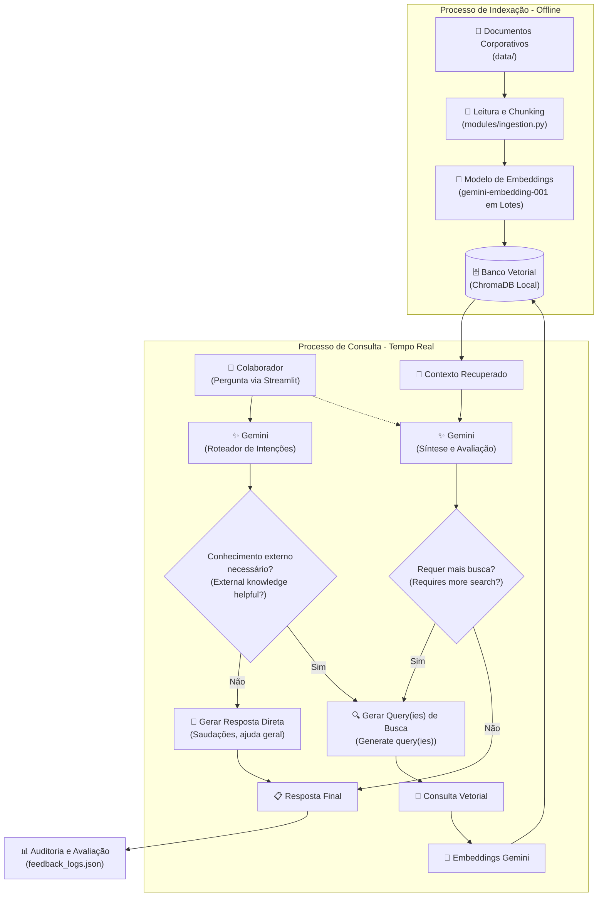

# 🤖 Alura Agent: Base de Conhecimento RAG Corporativo com Google Gemini

O **Alura Agent** é um assistente corporativo de Inteligência Artificial baseado na arquitetura **Agentic RAG (Retrieval-Augmented Generation)**. O agente permite que colaboradores consultem políticas de Recursos Humanos, manuais de integração técnica, contratos de sigilo, relatórios de mercado e diretrizes internas em linguagem natural, recebendo respostas precisas, fundamentadas e com citação das fontes consultadas.

---

## 🏗️ Arquitetura da Solução

A arquitetura do sistema é dividida em dois macroprocessos integrados: **Indexação Offline** e **Consulta em Tempo Real com Roteamento e Refinamento Autônomo**, conforme ilustrado no diagrama oficial do projeto:


### Fluxograma do Sistema



---

### Detalhamento dos Componentes da Arquitetura

#### 1. Processo de Indexação - Offline (`modules/ingestion.py`)
* **Extração Multiformato**: Suporta a leitura de documentos em PDF (`PyPDF`), Word (`python-docx`), planilhas Excel (`openpyxl`/`pandas`), slides PowerPoint (`python-pptx`), HTML (`BeautifulSoup`), Markdown e texto simples.
* **Chunking Semântico**: Divisão do texto em blocos de 700 caracteres com sobreposição de 100 caracteres (*overlap*), preservando o contexto entre parágrafos consecutivos.
* **Embeddings em Lote (Batching)**: Geração de vetores através da API do Gemini (`gemini-embedding-001`) enviando lotes de 16 blocos por requisição com controle de taxa (*backoff* exponencial), eliminando bloqueios por taxa de requisições (429).
* **Persistência Vetorial (`ChromaDB`)**: Armazenamento local dos vetores acompanhados de metadados como nome do arquivo, categoria e índice do bloco.

#### 2. Processo de Consulta - Tempo Real (`modules/rag_engine.py`)
* **Decisão de Conhecimento Externo (`External knowledge helpful?`)**: Antes de consultar a base vetorial, o Gemini avalia se a mensagem do usuário realmente demanda pesquisa documental. Saudações, agradecimentos ou dúvidas conceituais gerais são respondidas de imediato sem consumo desnecessário de busca vetorial.
* **Geração de Queries Otimizadas (`Generate query(ies)`)**: O modelo reformula a intenção do usuário em queries semânticas concisas, focando nas palavras-chave e conceitos técnicos (ex.: expandindo siglas como RH, OCI e SERIS).
* **Busca e Recuperação Contextual (`ChromaDB`)**: Recuperação dos trechos mais relevantes correspondentes a cada query gerada, com consolidação e desduplicação dos metadados.
* **Avaliação de Busca Adicional (`Requires more search?`)**: O agente analisa se o contexto recuperado é suficiente para responder integralmente à dúvida do colaborador. Se houver aspectos fundamentais pendentes, o agente executa uma rodada complementar de busca direcionada.
* **Síntese e Proteção Anti-Alucinação (`Final answer`)**: O Gemini correlaciona os documentos, sintetiza a explicação em linguagem clara e cita formalmente todas as fontes utilizadas. Se a informação estiver ausente, declara expressamente a inexistência na documentação.

---

## 🛠️ Tecnologias e Ferramentas Utilizadas

| Componente                       | Tecnologia                                         | Finalidade                                                                                                     |
| :------------------------------- | :------------------------------------------------- | :------------------------------------------------------------------------------------------------------------- |
| **Linguagem**                    | Python 3.10+                                       | Linguagem principal do ecossistema                                                                             |
| **Interface de Usuário**         | [Streamlit](https://streamlit.io/)                  | Frontend web interativo com controles de sessão e visualização de arquitetura                                  |
| **Modelos de Linguagem**         | [Google GenAI SDK](https://ai.google.dev/) (Gemini) | Modelos responsivos e resilientes (`gemini-3.1-flash-lite`, `gemini-3.5-flash-lite`, `gemini-3.8-flash`)       |
| **Embeddings**                   | `gemini-embedding-001`                             | Conversão de blocos textuais e queries de busca em vetores densos (3072 dimensões)                             |
| **Banco Vetorial**               | [ChromaDB](https://www.trychroma.com/)              | Banco vetorial local persistente de alta velocidade                                                            |
| **Processamento de PDFs**        | PyPDF / PyMuPDF                                    | Leitura e extração de códigos de conduta e relatórios técnicos em PDF                                          |
| **Processamento Office**         | `python-docx`, `openpyxl`, `python-pptx`           | Leitura de arquivos Word, planilhas Excel e apresentações PowerPoint                                           |
| **Manipulação de Dados**         | Pandas                                             | Tabulação e formatação estruturada de relatórios quantitativos                                                 |
| **Configuração e Ambiente**      | `python-dotenv`                                    | Gerenciamento seguro de credenciais via arquivo `.env`                                                         |

---

## 📁 Estrutura do Repositório

```text
agent-alura/
├── data/                               # Base de documentos corporativos
│   ├── rh/
│   │   ├── Codigo-de-Conduta-SERIS.pdf # Código de conduta profissional e regras de RH
│   │   └── intranet_avisos.html        # Comunicados internos e infraestrutura
│   ├── legal/
│   │   └── nda_contrato_sigilo.docx    # Acordo de confidencialidade da auFOOD
│   ├── operacional/
│   │   ├── onboarding_devs.pptx        # Guia de boas-vindas e stack de tecnologia
│   │   └── Demanda-de-Talentos-em-TIC.txt # Panorama e dados operacionais de talentos
│   ├── financeiro/
│   │   ├── analise_brasscom_estrategia.md # Posicionamento estratégico e contratação
│   │   └── Relatorio_Brasscom_Demanda_Talentos_TIC.xlsx # Planilha quantitativa setorial
│   └── edTech/
│       ├── Brasscom_Alura.docx         # Sinergia institucional Brasscom x Alura
│       ├── Demanda-de-Talentos-em-TIC.pdf # Relatório oficial de mercado
│       └── Alura Cursos Online.html    # Catálogo de formações e cursos
├── docs/
│   └── RAG.png                         # Diagrama da arquitetura do agente (Offline e Realtime)
├── modules/
│   ├── ingestion.py                    # Ingestão em lote e indexação resiliente no ChromaDB
│   └── rag_engine.py                   # Motor Agentic RAG com roteamento, refinamento e síntese
├── app.py                              # Interface Streamlit com painel de avaliação e visualizador
├── chroma_db/                          # Base de dados vetorial ChromaDB persistida localmente
├── feedback_logs.json                  # Registro de auditoria das avaliações dos usuários (👍/👎)
├── requirements.txt                    # Lista de dependências do ambiente Python
├── .env                                # Chave da API do Google Gemini (ignorado no Git)
├── .gitignore                          # Regras de exclusão do Git
├── LICENSE                             # Licença MIT
└── README.md                           # Documentação completa do projeto
```

---

## 🚀 Instruções de Instalação e Execução

### Pré-requisitos

* Python 3.10 ou superior instalado.
* Chave de API do Google Gemini ([Google AI Studio](https://aistudio.google.com/)).

### 1. Clonar o Repositório

```bash
git clone https://github.com/PedroZef/agent-alura.git
cd agent-alura
```

### 2. Criar e Ativar o Ambiente Virtual

> [!TIP]
> Ativar o ambiente virtual garante que os comandos `pip` e `python` apontem para os binários corretos, evitando mensagens como `'pip' não é reconhecido como um comando interno ou externo`.

No Windows (PowerShell):
```powershell
python -m venv venv
.\venv\Scripts\Activate.ps1
```

No Linux / macOS:
```bash
python3 -m venv venv
source venv/bin/activate
```

### 3. Instalar Dependências

Com o ambiente ativado:
```bash
pip install -r requirements.txt
```
*(Caso não deseje ativar o ambiente, utilize `.\venv\Scripts\pip.exe install -r requirements.txt` no Windows).*

### 4. Configurar as Credenciais

Crie um arquivo `.env` na raiz do projeto com a sua chave de API:
```env
GOOGLE_API_KEY=sua_chave_gemini_aqui
```

### 5. Executar a Ingestão dos Documentos

Para indexar todos os documentos corporativos na pasta `data/` com processamento em lotes otimizado:
```bash
python modules/ingestion.py
```
*(Ou `.\venv\Scripts\python.exe modules/ingestion.py` no Windows).*

### 6. Iniciar a Aplicação Web

Execute a interface gráfica Streamlit:
```bash
streamlit run app.py
```
*(Ou `.\venv\Scripts\streamlit.exe run app.py` no Windows).*

Acesse o endereço exibido no terminal (geralmente `http://localhost:8501`).

---

## 💡 Exemplos de Consultas Reais Testadas

Abaixo constam exemplos reais de interação validados no assistente:

### Exemplo 1: Código de Conduta e RH (Fonte: PDF)
* **Pergunta do Colaborador:**
  > *"O que o código de conduta diz sobre conflito de interesses e atividades paralelas?"*
* **Fluxo Executado:**
  * **Conhecimento Externo Necessário:** Sim
  * **Queries Geradas:** `código de conduta conflito de interesses`, `política de atividades paralelas emprego secundário`
  * **Fontes:** `Codigo-de-Conduta-SERIS.pdf (rh)`
* **Resposta do Agente:**
  > O Código de Conduta da SERIS estabelece orientações claras para assegurar que os interesses pessoais não entrem em conflito com os objetivos da empresa:
  > - **Atividades paralelas:** Não é permitido aceitar cargos ou funções em outras empresas ou entidades em horários conflitantes com o expediente na SERIS. Situações excepcionais devem ser registradas e avaliadas pelo RH.
  > - **Atividades em nome da empresa:** Qualquer atividade exercida utilizando o nome ou instalações da empresa requer aprovação prévia do Gerente Geral.
  > - **Prevenção e Dúvidas:** Em caso de dúvida sobre a existência de conflito de interesses, o colaborador deve consultar sua liderança direta ou a área de Recursos Humanos.

---

### Exemplo 2: Dúvida sobre Confidencialidade e NDA (Fonte: DOCX)
* **Pergunta do Colaborador:**
  > *"Quais ativos de tecnologia e dados o colaborador do auFOOD é obrigado a manter em sigilo absoluto?"*
* **Resposta do Agente:**
  > De acordo com o Contrato de Confidencialidade (NDA) do auFOOD, todos os colaboradores comprometem-se a manter sigilo absoluto sobre:
  > 1. Os algoritmos de recomendação do auFOOD;
  > 2. A estrutura do banco de dados vetorial;
  > 3. Os relatórios estratégicos da Brasscom utilizados internamente.
  > 
  > O vazamento de informações da arquitetura em nuvem (OCI) acarreta rescisão contratual imediata.
  > 
  > 📚 **Fontes consultadas:** `nda_contrato_sigilo.docx (legal)`

---

### Exemplo 3: Cruzamento Multidocumental Complexo (Estratégia + Mercado + Capacitação)
* **Pergunta do Colaborador:**
  > *"Com base no apagão de talentos de TIC e na meta de formar desenvolvedores em casa, de que forma as soluções da Alura auxiliam a auFOOD a superar esse déficit?"*
* **Resposta do Agente:**
  > Para contornar o déficit projetado pela Brasscom e viabilizar a estratégia da auFOOD:
  > 1. **Cenário de Mercado:** Diante da escassez e do encarecimento de profissionais seniores, a auFOOD foca na admissão de talentos juniores e plenos (`analise_brasscom_estrategia.md`).
  > 2. **Capacitação Alura:** A Alura fornece cursos e trilhas práticas em IA, Engenharia de Dados e Full-Stack (`Brasscom_Alura.docx`), acelerando o domínio das ferramentas corporativas adotadas na stack (`onboarding_devs.pptx`).
  > 3. **Segurança:** Todo o programa respeita as diretrizes de confidencialidade acordadas no NDA (`nda_contrato_sigilo.docx`).
  > 
  > 📚 **Fontes consultadas:** `analise_brasscom_estrategia.md (financeiro)`, `Brasscom_Alura.docx (edTech)`, `onboarding_devs.pptx (operacional)`, `nda_contrato_sigilo.docx (legal)`.

---

### Exemplo 4: Prevenção Anti-Alucinação (Informação Inexistente)
* **Pergunta do Colaborador:**
  > *"Qual é a política de reembolso para viagens internacionais de férias?"*
* **Resposta do Agente:**
  > Não encontrei essa informação na documentação interna disponível.  
  > *(O assistente recusa-se a inventar procedimentos ou políticas não documentadas).*

---

### Exemplo 5: Saudação / Conversa Informal (Ramo Direto)
* **Pergunta do Colaborador:**
  > *"Olá, bom dia! Como você pode me ajudar?"*
* **Fluxo Executado:**
  * **Conhecimento Externo Necessário:** Não (respondido diretamente sem acionar o banco vetorial)
* **Resposta do Agente:**
  > Olá! Bom dia! Sou o Assistente Virtual Corporativo interno da empresa. Posso te ajudar a consultar diretrizes de RH, código de conduta, contratos de sigilo, stack de tecnologia, onboarding e relatórios setoriais. Como posso ajudar você hoje?

---

## 🎛️ Recursos da Interface Web (`app.py`)

* **🗺️ Visualizador de Arquitetura no Navegador**: Seção expansível na barra lateral contendo o diagrama completo de arquitetura (`docs/RAG.png`).
* **⚡ Visualização do Fluxo de Execução**: Cada resposta traz um expansor detalhando a decisão de conhecimento externo, queries semânticas geradas, rodadas de busca e refinamento.
* **🗑️ Botão Limpar Histórico do Chat**: Localizado na barra lateral, permite ao usuário limpar todas as mensagens da sessão atual com um único clique.
* **👁️ Ocultar Mensagens no Navegador**: Interruptor para esconder temporariamente as mensagens da tela sem perder os dados da sessão.
* **👍 / 👎 Painel de Avaliações e Auditoria**: Registro imediato de feedbacks que alimentam as métricas da barra lateral e gravam as interações em [`feedback_logs.json`](feedback_logs.json).
* **🏷️ Rodapé Institucional**: Assinatura `@2026 - Pedro Zeferino da Silva.` presente na barra lateral e fixada no rodapé da aplicação.

---

## 📝 Licença e Direitos

Projeto desenvolvido para fins educacionais e corporativos.  
Distribuído sob a licença **MIT**. Consulte o arquivo [`LICENSE`](LICENSE) para mais detalhes.

© 2026 - Pedro Zeferino da Silva.
